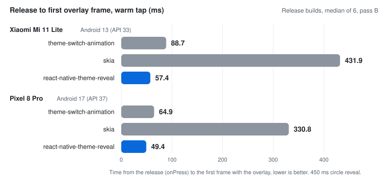
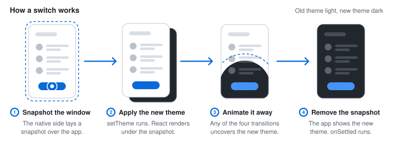

<div align="center">

# react-native-theme-reveal

**Animated theme switches for React Native.**<br>
A native snapshot of the window, a reveal from the touch point, no Reanimated.

[](https://www.npmjs.com/package/react-native-theme-reveal) [](https://github.com/chocky335/react-native-theme-reveal/actions/workflows/ci.yml)    [](LICENSE)

<table>
<tr>
<td colspan="4" align="center"><a href="docs/media/hero-star-reveal.mp4"></a></td>
</tr>
<tr>
<td colspan="4" align="center"><b>Custom shape</b><br><sub><code>transition: 'reveal'</code> with a star <code>shape</code></sub></td>
</tr>
<tr>
<td align="center"><a href="docs/media/reveal.mp4"></a></td>
<td align="center"><a href="docs/media/inverse-reveal.mp4"></a></td>
<td align="center"><a href="docs/media/wipe.mp4"></a></td>
<td align="center"><a href="docs/media/crossfade.mp4"></a></td>
</tr>
<tr>
<td align="center"><b>Reveal</b><br><sub><code>'reveal'</code></sub></td>
<td align="center"><b>Inverse reveal</b><br><sub><code>'inverseReveal'</code></sub></td>
<td align="center"><b>Wipe</b><br><sub><code>'wipe'</code>, <code>up</code></sub></td>
<td align="center"><b>Crossfade</b><br><sub><code>'crossfade'</code></sub></td>
</tr>
</table>

</div>

Animated theme switches for React Native, done with a native snapshot of the window. Right before
the app applies the new theme, the package lays the snapshot over the app. The theme changes
underneath, then the snapshot animates away. Components render the new theme once, and nothing has
to interpolate colours per component. The package has no runtime JS dependencies besides React,
React Native and Expo.

<table>
<tr>
<td width="33%" valign="top">

### 📸 Native snapshot

The window is captured natively and laid over the app. The new theme renders once, underneath.

</td>
<td width="33%" valign="top">

### 🎬 Four transitions

`reveal`, `inverseReveal`, `wipe` and `crossfade`, with a duration per type.

</td>
<td width="33%" valign="top">

### ⭐ Custom shapes

SVG path data replaces the circle for `reveal` and `inverseReveal`.

</td>
</tr>
<tr>
<td width="33%" valign="top">

### 👆 Snapshot on press-in

`pressCapture` takes the snapshot when the finger goes down, so the animation starts sooner.

</td>
<td width="33%" valign="top">

### 🪟 Modals

A switch from inside a React Native `<Modal>` animates too, on Android and iOS.

</td>
<td width="33%" valign="top">

### ♿ Reduce Motion

With Reduce Motion or Remove animations on, the theme switches without animating.

</td>
</tr>
<tr>
<td width="33%" valign="top">

### 🚀 GPU snapshot

On Android API 29 and up, the window draws again on the GPU. The default circle animates on the RenderThread.

</td>
<td width="33%" valign="top">

### 🔥 Warm-up

`useStart` prepares the native snapshot path once. Android also ships a Baseline Profile.

</td>
<td width="33%" valign="top">

### 🧪 Jest ready

Under `jest-expo` the native mock loads automatically. `switchTo` applies the theme at once.

</td>
</tr>
</table>

## Installation

```sh
npx expo install react-native-theme-reveal
npx expo prebuild
```

This is an [Expo module](https://docs.expo.dev/modules/overview/) with native code.

- Requirements: Expo SDK 57 or newer (React Native 0.86 or newer) and the New Architecture. iOS
  needs deployment target 16.4 or higher. Android installs on API 24 and up, but the animation needs
  API 26 (Android 8.0). On API 24 and 25 the theme switches without animating.
- Expo: Expo Go cannot load it. Use a development build (`npx expo run:android`,
  `npx expo run:ios`).
- Bare React Native: set up Expo modules first, then install the package and run `pod install`.
  This setup is not verified.

```sh
npx install-expo-modules@latest
npm install react-native-theme-reveal
cd ios && pod install
```

See [compatibility](#compatibility) for the full requirements.

## Quick start

```tsx
import { useRef, useSyncExternalStore } from 'react'
import { Pressable, Text, View } from 'react-native'
import type { GestureResponderEvent } from 'react-native'
import { createThemeReveal, originFromPress } from 'react-native-theme-reveal'

type Theme = 'light' | 'dark'

// getTheme has to read the theme synchronously, hence a small store outside React.
let theme: Theme = 'light'
const listeners = new Set<() => void>()
const themeStore = {
  get: () => theme,
  set: (next: Theme) => {
    theme = next
    listeners.forEach((listener) => listener())
  },
  subscribe: (listener: () => void) => {
    listeners.add(listener)
    return () => {
      listeners.delete(listener)
    }
  },
}

// One instance per app, at module scope.
const reveal = createThemeReveal<Theme>({ getTheme: themeStore.get, setTheme: themeStore.set })

export default function App() {
  const current = useSyncExternalStore(themeStore.subscribe, themeStore.get)
  reveal.useStart() // once, near the root
  const buttonRef = useRef<View>(null)

  const onPress = async (event: GestureResponderEvent) => {
    const origin = await originFromPress(event, buttonRef.current) // the ref is the fallback
    if (origin) reveal.setOrigin(origin.point, origin.viewTag)
    await reveal.switchTo(themeStore.get() === 'light' ? 'dark' : 'light')
  }

  return (
    <View style={{ flex: 1, backgroundColor: current === 'light' ? '#fff' : '#111' }}>
      <Pressable ref={buttonRef} onPress={onPress}>
        <Text style={{ color: current === 'light' ? '#111' : '#fff' }}>Switch theme</Text>
      </Pressable>
    </View>
  )
}
```

- `getTheme` must return the current theme synchronously. React state lags behind, so keep the theme
  somewhere you can read right away, like the store above.
- `setTheme` must update what React renders in the same tick, which the store above does.
- Create the instance at module scope, like above. Creating it during render trips the React hooks
  lint rules and the React Compiler.
- `originFromPress` reads the touch point from the press event. Presses from a keyboard, switch
  control or screen reader have no touch point, so it measures the view you pass and uses its centre
  instead. Unit tests cover that fallback. A TalkBack or VoiceOver activation on a real device is not
  verified.
- The default transition is `reveal` when there is an origin and `crossfade` when there is not.

The example app in [`example/`](example/) has every transition, a modal, the keyboard case and the
benchmark screen.

## Transitions

| Transition | What it does | Default |
| --- | --- | --- |
| `reveal` | A hole opens in the old screen at the origin and grows to show the new theme. It is a circle, or a shape you supply. | `450` ms |
| `inverseReveal` | The old screen stays visible only inside the shape, and the shape shrinks into the origin. The demo clip uses the star shape. | `450` ms |
| `wipe` | A straight edge sweeps across the screen and uncovers the new theme. The direction is the way the edge travels: with `up` the edge moves up and the new theme comes in from the bottom. | `400` ms, `up` |
| `crossfade` | The old screen fades out. | `300` ms |

```tsx
await reveal.switchTo('dark', { transition: 'wipe', wipeDirection: 'left' })
```

- `reveal` and `inverseReveal` need an origin. Without one they fall back to `crossfade`.
- `reveal` grows the shape from 24 pt tall to the scale that covers the farthest window corner. It
  follows `scale(g) = from * (to / from) ^ (g ^ 1.4)`, with `g` linear in time. `inverseReveal` runs
  the same curve backwards.
- `wipe` and `crossfade` use a cubic ease in-out (`0.65, 0, 0.35, 1`).
- The clips at the top are screen recordings of the example app (release build) on a Pixel 8 Pro,
  cut to 30 fps with the status bar cropped out. Click one to get the MP4.

## Snapshot on press-in

By default `switchTo` takes the snapshot when the press ends. With `reveal.pressCapture` the package
takes it when the press starts instead, so the snapshot is ready by the release and the animation
starts sooner. Spread it on the `Pressable` whose `onPress` calls `switchTo`:

```tsx
<Pressable ref={buttonRef} {...reveal.pressCapture} onPress={onPress}>
```

- `onPressIn` takes the snapshot and keeps it off screen, so the screen stays live while the finger
  is down.
- `onPress` calls `switchTo`, which puts the held snapshot on screen right away.
- A press that ends without `onPress` (the finger slid off the button, or a scroll took over) only
  gets `onPressOut`, which frees the snapshot. It does that in a later macrotask, because on release
  React Native calls `onPressOut` either before `onPress` in the same dispatch or, for a short press,
  up to 130 ms after it. A late `onPressOut` from an earlier press leaves the next press's snapshot
  alone.
- In `onPress`, call `switchTo` before any `await` that waits on native work. Otherwise the deferred
  `onPressOut` can free the snapshot first, and the switch takes a new one at release as if
  `pressCapture` were not there. `await originFromPress(event)` is fine when the event has a touch
  point.
- The press-in point becomes the origin for the next switch, like `setOrigin`. A later `setOrigin`
  call wins.
- Every press-in costs a full-window snapshot, even when the touch turns into a scroll. Do not use
  `pressCapture` on buttons inside a scrolling list.

On Android the press-in snapshot takes the same path as a snapshot at release (see
[How it works on Android](#how-it-works-on-android)):

| Android | Snapshot | Memory while held | Time |
| --- | --- | --- | --- |
| API 29 and up | GPU snapshot | A window-size hardware bitmap, about 10 MB of GPU memory at 1080 x 2400 | 2-8 ms on the main thread. Ready 10-30 ms after the capture starts on a Mi 11 Lite and a Pixel 8 Pro. |
| API 26 to 28 | `PixelCopy` | A window-size bitmap, about 10 MB | 25-47 ms of GPU readback on a Mi 11 Lite. The bitmap is the one the warm-up keeps, and it goes back there if no switch uses the snapshot. |

### What the snapshot shows

The snapshot shows the screen at press-in, not at release. In pixels, that means:

- The button shows up the way it looked just before the press, with no press feedback. React Native
  draws the pressed style and the ripple in a frame after `onPressIn`, so the snapshot does not have
  them. At release the feedback goes away at once, hidden under the snapshot.
- Without `pressCapture`, the snapshot at release shows the pressed look, so the old screen keeps the
  press feedback until the animation uncovers it.
- Anything that moved during the press (a clock, a running animation, a progress bar) shows as it was
  at press-in. The snapshot is one press old.

This was checked on a Mi 11 Lite and a Pixel 8 Pro with a button that has a pressed background colour
and `android_ripple`, using both the `PixelCopy` snapshot and the GPU snapshot. The first overlay
frame matched the idle button with `pressCapture` and the pressed button without it. Outside the
reveal hole, the press-in snapshot matched the screen at press-in pixel for pixel. The screen stays
live during the hold: with a 300 ms hold, the pressed colour and the ripple stayed visible until the
release on both phones. iOS takes its snapshot the same way (`afterScreenUpdates: false`). The look
on iOS is not verified, because the simulator cannot hold a press.

If you need the exact release frame, skip `pressCapture`.

### When the switch takes a new snapshot

The switch falls back to a new snapshot at release in these cases:

| Condition | Detail |
| --- | --- |
| No switch used the held snapshot within 3 s | The package frees it, or hands it back as the kept bitmap (see [Warm-up](#warm-up)). A long press then does not hold a second full-window bitmap (about 10 MB at 1080 x 2400 on Android). The press-in point stays the origin. |
| The window changed size, or the switch comes from another window | On Android, another window means another modal. |
| The app went to the background | |
| `switchTo` got the current theme | |
| A newer press-in replaced the snapshot | |
| Another switch started while the press-in snapshot was being taken | The snapshot could show the screen from before that switch. That holds even when the other switch ended without an animation. |
| On iOS, a modal was presented during the press, or finished closing during it | |
| A switch animation was on screen at press-in | The package takes no snapshot then, since it would capture that animation's current frame. |

On Android, if the release comes before the press-in snapshot is ready, the switch waits for it and
shows it. It does not take a second one.

### iOS

iOS has the same API. There the package takes the key window's
`snapshotView(afterScreenUpdates: false)` at press-in and adds it to the window at release. That
snapshot is cheap on iOS anyway, so the gain is small.

- iOS ignores the view tag for the press-in snapshot, because it always snapshots the key window.
- Modals open in that same window, so the package also compares the window's top presented view
  controller. If a modal was presented during the press, or finished closing during it, the switch
  takes a new snapshot.
- A modal that is still closing at release counts as presented, so the switch uses the press-in
  snapshot. That snapshot shows the modal where it was at press-in, even though the modal is partway
  through its closing animation by then.

## Shapes

A shape is SVG path data plus two numbers that position and scale it, all in path units.

```ts
const STAR: Shape = {
  path:
    'M50 0 L62.93 32.2 L97.55 34.55 L70.92 56.8 L79.39 90.45 L50 72 ' +
    'L20.61 90.45 L29.08 56.8 L2.45 34.55 L37.07 32.2 Z',
  anchor: { x: 50, y: 50 },
  inscribedRadius: 21.99,
}

const onPress = async (event: GestureResponderEvent) => {
  const origin = await originFromPress(event)
  if (origin) reveal.setOrigin(origin.point, origin.viewTag) // a reveal with no origin falls back to crossfade
  await reveal.switchTo('dark', { transition: 'reveal', shape: STAR })
}
```

| Field | Type | Description |
| --- | --- | --- |
| `path` | `string` | SVG path data, filled with the nonzero rule on both platforms. |
| `anchor` | `Point` | The point in the shape that lands on the origin. |
| `inscribedRadius` | `number` | Distance from the anchor to the nearest edge of the shape. The package uses it to work out the scale at which the shape covers the whole window. |

- A shape applies to `reveal` and `inverseReveal` only.
- Use an `inscribedRadius` at or below the real distance. Too large a value makes the final scale too
  small, and whatever the shape missed snaps to the new theme at the end.
- Separate the arc flags (`a9 9 0 0 1 18 0`, not `a9 9 0 0118 0`). Android's parser cannot split
  compact flags, although iOS reads them fine.
- If the path does not parse, the package falls back to the circle and logs a warning that names the
  path. On Android, a path with compact arc flags ends up as the circle.

## Modals

A switch from inside a React Native `<Modal>` animates too.

- Android: a modal is its own dialog window. Pass the tapped view's tag
  (`setOrigin(point, viewTag)`, which `originFromPress` gives you). The package then snapshots the
  activity window, the dim behind the dialog and the dialog itself, and puts the overlay in the
  dialog window. Without a `viewTag` it uses whichever window has focus.
- iOS: a modal is in the same window, so the snapshot includes it. Inside a `pageSheet` or
  `formSheet` modal, pass the `viewTag` too (see [`setOrigin`](#setorigin)).

See [Limits](#limits) for the modal cases that do not animate fully.

## Reduce Motion and backgrounding

| Case | Result |
| --- | --- |
| iOS with Reduce Motion on | The theme switches without animating. |
| Android with the animator duration scale at 0 (Remove animations) | The theme switches without animating. |
| The app is paused or in the background | A switch applies the theme without animating. The app must be in the foreground to animate. |
| A snapshot never gets its animation start | It is removed after 1 s, so it cannot get stuck on screen. |
| The app goes to the background while a press-in snapshot is held | The press-in snapshot is freed. |

## Warm-up

The first switch in a process pays for work that later switches skip. To move that work out of the
way, with `warmUp: true` (the default) `useStart()` calls the native `warmUp` once per instance, the
first time it mounts. On Android the warm-up starts the snapshot copy thread, off the main thread.
Then it prepares whichever path the activity window's first switch will take (see
[How it works on Android](#how-it-works-on-android)). The warm-up also loads most of the package's
classes on its own thread, so the first switch does not load them on the main thread.

- If you have several instances, the warm-up runs as long as any of them has `warmUp: true`.
- With `warmUp: false` there is no warm-up at all: no thread start, no GPU snapshot of nothing, no
  copy, no kept bitmap and no kept capture target. Every snapshot then allocates its own bitmap and
  its own target.
- On iOS `warmUp` does nothing, since the snapshot there has no thread or bitmap to prepare.
- If the warm-up fails, the error goes to `onError` and switches keep working.

### GPU snapshot path (API 29 and up)

The warm-up makes a 1 x 1 GPU snapshot of nothing on the copy thread: an `ImageReader`, a
`HardwareRenderer` and one drawn frame, which it then frees. It draws no view, so the window is not
touched. It keeps no bitmap, because each GPU snapshot makes its own hardware bitmap and frees it with
the snapshot. A switch that falls back to `PixelCopy` keeps its bitmap, the same as on API 26 to 28.

Then, 500 ms after the mount and once the main thread is next idle, it makes one capture target the
size of the activity window on the copy thread: an `ImageReader`, a `HardwareRenderer` with its
surface, and one allocated buffer. It holds on to that target until a snapshot of the activity window
uses it, so that snapshot skips the setup. What the kept target gains on its own is not measured.

- The package makes the next target the same way, 500 ms after a switch ends or after a press-in
  snapshot that no switch used.
- It waits while an overlay shows, a snapshot runs or a press-in snapshot is held. It tries again
  when the activity comes back to the foreground.
- A switch that starts while a target is being made waits for it. Its snapshot gets its image after
  that work ends, 11.5-23.8 ms on a Mi 11 Lite.

What it gains, on the first switch in a fresh process (3 runs each):

| Device | Measure | Without warm-up | With warm-up |
| --- | --- | --- | --- |
| Pixel 8 Pro (API 37) | Main thread time on the snapshot | 18.2-19.0 ms | 2.9-5.7 ms |
| Pixel 8 Pro (API 37) | Snapshot ready after the switch started | 23.8-28.2 ms | 10.3-12.9 ms |
| Mi 11 Lite (API 33) | Main thread time on the snapshot | 3.9-7.1 ms | No measurable change |

On the Pixel 8 Pro, the first `ImageReader` in the process accounted for 13.4-14.7 ms of the time
without the warm-up.

What it costs:

- Time: 30-44 ms on the copy thread at mount on the Pixel 8 Pro and 4 ms on the Mi 11 Lite, for the
  1 x 1 snapshot. Each kept target adds 11.5-23.8 ms on the copy thread and 4.4-18.7 ms on the
  RenderThread on the Mi 11 Lite (from a system trace).
- Frames: the RenderThread draws your app's frames too. On a slow phone one app frame can come late
  while the package makes a target: about 0.5 s after the mount and about 0.5 s after each switch.
  That only matters if your app animates right then. The benchmark cannot see it, because its screen
  sits still after a switch.
- Memory: one window-size GPU buffer between switches, with a started `HardwareRenderer` and its
  surface. The buffer is 4 bytes per pixel, so about 10 MB at 1080 x 2400, and the package keeps one
  at most. This is not verified with `dumpsys meminfo`.

The package frees the kept target when:

| Trigger | What happens next |
| --- | --- |
| The app goes to the background (`onTrimMemory` at `TRIM_MEMORY_UI_HIDDEN` or above) | Nothing is kept until the next snapshot. The package keeps a new target after that switch. |
| The system is low on memory | |
| The screen size changes | |
| At the next prepare, the activity window has a different size or its snapshot no longer takes the GPU path | If the GPU path is on, the package makes a new target that fits. |
| The activity is destroyed | |
| The GPU snapshot turns itself off | |
| The module is destroyed (a JS reload) | |

A snapshot of a window with a different size frees the target and makes its own. The free runs on the
copy thread before that snapshot's image gets there, so the image can end up waiting for it.

### PixelCopy path (API 26 to 28)

The warm-up takes this path on API 26 to 28. It also takes it for an API 29+ activity window that
takes `PixelCopy` (see [How it works on Android](#how-it-works-on-android)), and in a process where
the GPU snapshot switched itself off before the warm-up ran. The warm-up allocates one bitmap the size
of the window on the copy thread, copies the window into it once and keeps it. The first copy into a
fresh bitmap is the slow one, so this way the first switch gets a fast copy.

- Every `PixelCopy` snapshot copies into the kept bitmap and gets it back when the snapshot goes
  away. A press-in snapshot that no switch used gives it back too. Inside a modal, the copy of the
  dialog window still allocates a new bitmap each time.
- Memory: one ARGB bitmap the size of the window, held while the app runs. At 4 bytes per pixel that
  is about 10 MB at 1080 x 2400. GPU memory did not grow: on a Pixel 8 Pro, `dumpsys meminfo` showed
  100 MB of Graphics with and without the kept bitmap. Other GPUs are not measured.
- Time: the one copy at mount takes the RenderThread once, for 16-26 ms on a Mi 11 Lite and 39-60 ms
  on a Pixel 8 Pro. These numbers were measured before those phones moved to the GPU snapshot. If
  your app animates in its first frames, one of them can come late.
- The bitmap is freed when the app goes to the background (`onTrimMemory` at `TRIM_MEMORY_UI_HIDDEN`
  or above), on low memory, when the screen size changes and when the activity is destroyed. Nothing
  is kept while the app is in the background, and the next switch keeps a new bitmap.

### Baseline Profile

The Android library ships a Baseline Profile (`android/src/main/baseline-prof.txt`) with all of its
classes and methods in it. The Android Gradle Plugin packs it into the library's AAR and merges it
into the app's `assets/dexopt/baseline.prof`. A Play install then compiles that code ahead of time,
and the first switch does not run it in the interpreter.

A local `adb install` does not apply profiles. To get the same result as Play, add
`androidx.profileinstaller` 1.4.0 or later to the app (1.3.x does nothing on Android 15 and later) and
run:

```sh
adb shell am broadcast -a androidx.profileinstaller.action.INSTALL_PROFILE <package>/androidx.profileinstaller.ProfileInstallReceiver
adb shell am force-stop <package>
adb shell cmd package compile -f -m speed-profile <package>
```

The benchmark in [`benchmark/`](benchmark/) compiles all of the app's code ahead of time for every
library, so it does not show what this profile does for a Play install.

## Limits

| Case | Android | iOS |
| --- | --- | --- |
| The keyboard | Not in the snapshot. It keeps its own theme. | Not in the snapshot. It changes theme immediately. |
| A second switch mid-animation | Ends the first one immediately and shows one frame of the end state. | Ends the first one immediately. The second snapshot captures the first animation's current frame, and the second animation starts from that. |
| A modal closed in the same handler that switches ("close on select") | The switch does not animate. | The reveal plays over a snapshot that still shows the modal. |

- Android below 8.0 (API 26): the theme still switches, without animation.
- New Architecture only.
- For "close on select", switch once the modal has closed.
- Android modal: a tap while the modal is still sliding in shows about 2 frames of live content on top
  of it.
- Android modal: with stacked modals, only the target dialog ends up in the snapshot.
- Android modal: if the dialog window is smaller than the screen, the strip outside it stays live.
- To follow the system theme, listen to `Appearance` and call `switchTo` without an origin. That gives
  a `crossfade`. The example app does this.

## API

```ts
import {
  createThemeReveal,
  originFromPress,
  resolveTransition,
  ThemeRevealModule,
} from 'react-native-theme-reveal'
```

### Functions

| Function | Returns | Description |
| --- | --- | --- |
| `createThemeReveal<T>(options)` | `ThemeReveal<T>` | Creates the instance. Create one per app, at module scope (outside render). See [Options](#options). |
| `originFromPress(event, fallbackView?)` | `Promise<PressOrigin \| null>` | Returns the origin for a press. See [`originFromPress`](#originfrompress). |
| `resolveTransition(input)` | `Transition` | Pure function that picks the transition, shape, direction and duration for a switch. `switchTo` uses it internally. It is exported for tests and custom flows. |

### Options

The options of `createThemeReveal`:

| Option | Type | Default | Description |
| --- | --- | --- | --- |
| `getTheme` | `() => T` | required | Returns the current theme. Must be synchronous. |
| `setTheme` | `(theme: T) => void` | required | Applies the theme. It runs while the snapshot is on screen, and must update what React renders in the same tick. |
| `transition` | `'reveal' \| 'inverseReveal' \| 'wipe' \| 'crossfade'` | `'reveal'` with an origin, else `'crossfade'` | App-wide default. |
| `shape` | `Shape` | a circle | Default shape for `reveal` and `inverseReveal`. See [Shapes](#shapes). |
| `wipeDirection` | `'up' \| 'down' \| 'left' \| 'right'` | `'up'` | Default direction for `wipe`. |
| `durations` | `Partial<Record<TransitionType, number>>` | `450` / `450` / `400` / `300` ms | Per transition type, in ms. Anything non-finite, 0 or below, or over 10 000 falls back to the default. |
| `onError` | `(error: unknown) => void` | `console.warn` | Receives native errors. The theme still applies if the snapshot fails. |
| `onSettled` | `(info: SettledInfo) => void` | - | Called when a switch finishes, with `{ transition, capture, prepareMs, totalMs }`. |
| `warmUp` | `boolean` | `true` | Prepares the native snapshot path when `useStart` mounts. On API 29 and up that is the GPU snapshot. Below that it keeps one window-size bitmap. See [Warm-up](#warm-up). |

- Do not `await` anything before the update in `setTheme`, and do not wrap it in `startTransition`.
  If the update is deferred, the animation runs over the old theme and the new one appears all at
  once afterwards.
- If `setTheme` throws, the package removes the snapshot and releases the held theme, and `switchTo`
  rejects with that error. That switch gets no `onSettled` call.
- In `onSettled`, `transition` is `null` when no snapshot was taken (the theme switched without
  animating). If a snapshot was taken, `transition` is the type, even when native ended up showing no
  animation (for example, when Android's animator duration scale is 0).
- `capture` says how the snapshot was taken: `'gpu'` (API 29 and up, see
  [How it works on Android](#how-it-works-on-android)), `'pixelcopy'` (Android readback) or `'view'`
  (iOS `snapshotView`). It is `null` when no snapshot was taken.
- If starting the animation fails, `onError` runs first, then `onSettled`.
- Same-theme calls get no `onSettled`. A call that a newer call replaced before its snapshot was taken
  gets no `onSettled` either. A call replaced mid-animation still does.
- If `onError` or `onSettled` throws, the error goes to `console.warn` and the theme still applies.

### Methods

The methods of the `ThemeReveal<T>` instance:

| Method | Description |
| --- | --- |
| `setOrigin(point, viewTag?)` | Sets the origin for the next switch only. Call it from the press handler, before `switchTo`. |
| `switchTo(theme, options?)` | Switches to `theme` with an animation. Returns `Promise<void>`. |
| `pressCapture` | `{ onPressIn(event), onPressOut(event?) }` for a `Pressable`. See [Snapshot on press-in](#snapshot-on-press-in). |
| `capture(point, viewTag?)` | Takes the snapshot now and keeps it off screen for the next `switchTo`. |
| `dropCapture()` | Frees the press-in snapshot. It also clears the origin that `capture` set, unless `setOrigin` set a newer one. |
| `useStart()` | Hook that starts the animation once React has committed the new theme. |
| `useHeldTheme()` | Hook that returns the previous theme (`T`) while an animation runs, and `null` otherwise. |

#### `setOrigin`

`point` is in `pageX` / `pageY` space and `viewTag` is the tapped view. `originFromPress` returns
both.

- Android: `viewTag` tells the package which window to snapshot (see [Modals](#modals)).
- iOS: `viewTag` identifies the React root that `point` is measured in. Inside a `pageSheet` or
  `formSheet` modal that root is not at the top of the window, so pass the tag there. Without a tag,
  `point` is treated as window points.

#### `switchTo`

| Option | Type | Description |
| --- | --- | --- |
| `transition` | `TransitionType` | This switch only. |
| `shape` | `Shape` | This switch only. |
| `wipeDirection` | `WipeDirection` | This switch only. |

- The most specific choice wins: the `switchTo` option, then the factory option, then the default.
- `reveal` and `inverseReveal` need an origin, and fall back to `crossfade` without one.
- If `theme` is already current, `switchTo` removes any snapshot that is on screen, frees a press-in
  snapshot and returns.
- The newest `switchTo` call wins. An older call still waiting for its snapshot does nothing.
- If the snapshot fails, `setTheme` still runs without animation. On Android API 29 to 33 there is one
  case where it waits instead, see [How it works on Android](#how-it-works-on-android).
- The promise resolves once the theme is set, before the animation ends. Use `onSettled` if you need
  the end.
- It only rejects if `getTheme` or `setTheme` throws.

#### `pressCapture`

- `onPressIn` calls `capture` with the touch point (`pageX`, `pageY`) and `event.nativeEvent.target`.
  If the event has no finite touch point, it does nothing and the switch takes its snapshot at
  release.
- `onPressOut` frees the press-in snapshot in a later macrotask, if no `switchTo` has used it by then.
  Pass it the press event (`Pressable` does). An `onPressOut` whose touch is older than the snapshot's
  press-in is ignored.

#### `capture`

`capture` also sets `point` and `viewTag` as the origin for the next switch, like `setOrigin`.

- A second `capture` replaces the first.
- If no switch uses the snapshot within 3 s, the package frees it. The point stays the origin until
  the press ends.
- If the native capture fails, the error goes to `onError` and the next switch takes its snapshot as
  usual.

#### `useStart`

Mount it once, in a component that re-renders when the theme changes (the root is a good spot). The
first time it mounts, it also warms up the native side (see [Warm-up](#warm-up)).

#### `useHeldTheme`

Use it for anything outside the snapshot that must keep the old look until the animation ends, like
the system bar style:

```tsx
const held = reveal.useHeldTheme()
const barTheme = held ?? theme

return <StatusBar barStyle={barTheme === 'light' ? 'dark-content' : 'light-content'} />
```

The system bars stay live above the snapshot. If you switch their style right away, they change
before the animation has shown the new theme.

#### `originFromPress`

`originFromPress(event, fallbackView?)` returns `{ point, viewTag }` for a press event. `point` is the
touch point (`pageX`, `pageY`) and `viewTag` is `event.nativeEvent.target`. If the event has no finite
touch point, it measures `fallbackView` with `measureInWindow` and returns its centre. Without a
`fallbackView`, it returns `null`.

- Call it synchronously in the press handler, before any `await`.
- Pass a view that is mounted. React Native never calls back `measureInWindow` for an unmounted view,
  so the promise would never settle.

#### `ThemeRevealModule`

The native module. `createThemeReveal` calls it for you, so normally you do not need it.

| Method | Returns | Description |
| --- | --- | --- |
| `prepare(viewTag?)` | `Promise<CapturePath \| null>` | Takes the snapshot. Resolves to the `CapturePath`, or `null` when it shows no snapshot. |
| `start(transition)` | `Promise<void>` | Starts the animation. |
| `cancel()` | `Promise<void>` | Removes the snapshot. |
| `warmUp()` | `Promise<void>` | Runs the [warm-up](#warm-up). |
| `capture(viewTag?)` | `Promise<boolean>` | Takes a press-in snapshot. |
| `dropCapture()` | `Promise<void>` | Frees the press-in snapshot. |

### Types

```ts
type Point = { x: number; y: number }
type Shape = { path: string; anchor: Point; inscribedRadius: number }
type WipeDirection = 'up' | 'down' | 'left' | 'right'
type Transition =
  | { type: 'reveal'; origin: Point; durationMs: number; shape?: Shape }
  | { type: 'inverseReveal'; origin: Point; durationMs: number; shape?: Shape }
  | { type: 'wipe'; direction: WipeDirection; durationMs: number }
  | { type: 'crossfade'; durationMs: number }
type TransitionType = Transition['type']
type CapturePath = 'gpu' | 'pixelcopy' | 'view'
type SettledInfo = {
  transition: TransitionType | null
  capture: CapturePath | null
  prepareMs: number
  totalMs: number
}
type SwitchOptions = { transition?: TransitionType; shape?: Shape; wipeDirection?: WipeDirection }
type PressOrigin = { point: Point; viewTag?: number }
type PressCapture = { onPressIn(event: GestureResponderEvent): void; onPressOut(event?: GestureResponderEvent): void }
type MeasurableView = {
  measureInWindow(callback: (x: number, y: number, width: number, height: number) => void): void
}
type ResolveTransitionInput = {
  requested?: TransitionType // the switchTo option
  fallback?: TransitionType // the factory option
  origin: Point | null
  shape?: Shape
  durations?: Partial<Record<TransitionType, number>>
  wipeDirection?: WipeDirection
  requestedShape?: Shape
  requestedWipeDirection?: WipeDirection
}
```

`ThemeRevealOptions<T>` is the options object for `createThemeReveal` (the [Options](#options)
table) and `ThemeReveal<T>` is what it returns. All of these types are exported.

## Testing with Jest

Under `jest-expo` the package's native module mock loads automatically. No setup is needed.

```tsx
await reveal.switchTo('dark') // setTheme runs at once, no animation
```

- The mock ships in the package as `mocks/ThemeReveal.js`.
- `prepare` resolves `null`, so `switchTo` applies the theme immediately without animating.
  `onSettled` then gets `transition: null` and `capture: null`.
- `capture` resolves `false`. `start`, `cancel`, `warmUp` and `dropCapture` resolve with no value.

## Compatibility

| | Requirement |
| --- | --- |
| Expo / React Native / React | Expo SDK 57 or newer, React Native 0.86 or newer. Peer ranges: `expo >=57.0.0`, `react-native >=0.86.0`, `react *`. |
| Architecture | New Architecture only |
| iOS | Deployment target 16.4 |
| Android | Installs on API 24. The animation needs API 26 (Android 8.0). The GPU snapshot needs API 29. |
| Expo Go | Not supported. Use a development build. |
| Bare React Native | Through `install-expo-modules`. Not verified. |
| Runtime JS dependencies | React, React Native and Expo only. No Reanimated, no gesture handler. |

The package is developed against Expo SDK 57, React Native 0.86.3 and React 19.2.3. The
measurements in this README come from a Xiaomi Mi 11 Lite (Android 13, API 33), a Pixel 8 Pro
(Android 17, API 37) and the iOS 26.5 simulator.

## Performance

Measured on 2026-11-08 with release builds, in two full passes (A and B). The tables below are from
pass B. Since then the code has only changed in the docs, code comments, debug log text and the
module's destroy, and no benchmark run takes a path whose behaviour those change. The method, raw
dumps and scripts live in [`benchmark/`](benchmark/). The full tables of both passes, the history
and the notes are in [`benchmark/RESULTS.md`](benchmark/RESULTS.md).

In this build, on API 29 and up, the circle reveal runs on the RenderThread from a second snapshot
(see [Circle reveal on the RenderThread](#circle-reveal-on-the-renderthread)). The inside of the
circle is then a still image of the new screen for the reveal's 450 ms. The UI-thread reveal still
runs on API 26 to 28, for a `PixelCopy` snapshot, for a custom shape, and for one switch when the
second snapshot fails.

Everything runs in one build of the example app, on the same screen, with a 450 ms circle reveal:

- `ours`: this package.
- `theme-switch-animation`: `react-native-theme-switch-animation` 0.8.0.
- `skia`: the Skia technique, `@shopify/react-native-skia` `makeImageFromView` with a circle mask
  animated by Reanimated.

<picture>
  <source media="(prefers-color-scheme: dark)" srcset="docs/assets/overlay-frame-dark.svg">
  
</picture>

| Device | OS | Build | Runs per library |
| --- | --- | --- | --- |
| Xiaomi Mi 11 Lite (`M2101K9AG`) | Android 13 (API 33) | release, `arm64-v8a`, compiled with `speed` | warm: 1 warm-up + 6 interleaved rounds. Cold: 3 rounds |
| Pixel 8 Pro | Android 17 (API 37) | release, `arm64-v8a`, compiled with `speed` | warm: 1 warm-up + 6 interleaved rounds. Cold: 3 rounds |

Warm, `input tap` (median of 6). Lower is better in every column.

| Device | Library | Overlay frame (ms) | Snapshot, JS (ms) | Frame p50 (ms) | Frame p90 (ms) | Janky (%) | Late frames | Missed vsyncs | JS max gap (ms) |
| --- | --- | --- | --- | --- | --- | --- | --- | --- | --- |
| Mi 11 Lite | ours | 57.4 | 47.2 | 15.3 | 20.6 | 38 | 0 | 2 | 43.0 |
| Mi 11 Lite | theme-switch-animation | 88.7 | 73.2 | 17.7 | 24.0 | 67 | 0.5 | 3.5 | 45.0 |
| Mi 11 Lite | skia | 431.9 | 414.0 | 18.9 | 22.8 | 67 | 0 | 25 | 391.1 |
| Pixel 8 Pro | ours | 49.4 | 45.9 | 7.7 | 9.3 | 0 | 0 | 2 | 25.4 |
| Pixel 8 Pro | theme-switch-animation | 64.9 | 66.2 | 8.2 | 9.5 | 3 | 0 | 3 | 32.2 |
| Pixel 8 Pro | skia | 330.8 | 291.4 | 6.9 (1) | 8.9 (1) | 0 (1) | 0 (1) | 9.5 (1) | 267.9 |

Overlay frame and snapshot JS in all four forms, ours against `theme-switch-animation` (ms):

| Device | Form | Overlay frame: ours | Overlay frame: theme-switch-animation | Snapshot, JS: ours | Snapshot, JS: theme-switch-animation |
| --- | --- | --- | --- | --- | --- |
| Mi 11 Lite | Warm tap | 57.4 | 88.7 | 47.2 | 73.2 |
| Mi 11 Lite | Warm hold | 41.0 | 94.2 | 31.6 | 80.2 |
| Mi 11 Lite | Cold tap | 65.5 | 88.0 | 58.0 | 84.1 |
| Mi 11 Lite | Cold hold | 43.0 | 107.7 | 33.9 | 67.6 |
| Pixel 8 Pro | Warm tap | 49.4 | 64.9 | 45.9 | 66.2 |
| Pixel 8 Pro | Warm hold | 39.1 | 64.5 | 31.7 | 64.0 |
| Pixel 8 Pro | Cold tap | 53.8 | 89.5 | 47.5 | 87.6 |
| Pixel 8 Pro | Cold hold | 39.1 | 102.2 | 32.2 | 65.3 |

(1) Skia drew at 30 Hz on the Pixel 8 Pro, so its frame times, janky share, late frames and missed
vsyncs there cannot be compared with the other two. Its missed vsyncs are counted in 33 ms intervals,
so 9.5 is about 19 at 60 Hz. That is why the release rule leaves Skia out of the Pixel 8 Pro frame
rows. With Skia in them, 7 more rows would fail in pass B: frame p50 in all four forms, frame p90 in
cold tap, and janky share in cold tap and cold hold.

- Overlay frame: time from the release to the first frame with the overlay on screen. On the Mi 11
  Lite a system trace confirmed which frame that is. On the Pixel 8 Pro it rests on `gfxinfo` data
  alone.
- Snapshot, JS: time from the release until JS knows the overlay is up.
- JS max gap: longest gap between two `requestAnimationFrame` callbacks during the switch.
- On React Native 0.86 (Fabric), `theme-switch-animation` shows no visible circle. It reveals the old
  screen over the old screen, and the new theme appears all at once at the end. Its timings are still
  real.

<details>
<summary><b>Read how the runs were done</b></summary>
<br>

- Before each pass the benchmark compiles the whole app ahead of time
  (`cmd package compile -f -m speed`), so all three libraries run compiled code. That means it does
  not show what the [Baseline Profile](#baseline-profile) does for a Play install.
- Each pass runs with two kinds of tap, the same for every library. `input tap` holds the press for
  about 0 ms, which no finger does, so there is also a hold form that presses for 100 ms
  (`input swipe x y x y 100`). The clock starts at the release (`onPress`) in both. Ours takes its
  snapshot on press-in ([Snapshot on press-in](#snapshot-on-press-in)), so the hold form is closer to
  what a finger gets.
- Cold means the first switch in a fresh process: the app is force-stopped 1 s before each run. The
  screen mounts about 1.5 s before the tap, so the warm-up has finished by then. If your app's first
  switch comes sooner, it will not look like this.
- Every `ours` run took the GPU snapshot (`capture=gpu`). The result files do not record a fallback to
  the UI-thread reveal. Debug passes with the debug log on saw none: one on the Mi 11 Lite with this
  build, and one on the Pixel 8 Pro with an earlier build of the same design.
- Both phones drew at 60 Hz, except Skia on the Pixel 8 Pro, which drew at 30 Hz.

</details>

### Release rule

On each Android device, each of our medians must be no more than 5% above the best alternative's
median. That is 16 rows per form, 64 in all. Pass A passes all 64 and pass B passes 63. The overlay
frame and snapshot JS pass in every form on both phones in both passes.

The one row that fails is the Mi 11 Lite JS max gap in pass B's warm hold: 44.1 ms vs 39.7 ms for
`theme-switch-animation` (limit 41.7 ms). A system trace of 6 runs on the same build shows this
package caused none of the max gaps.

- On the Mi, our JS max gap per run is either fast (25.4-31.8 ms) or slow (41.8-51.2 ms) in 22 of 24
  runs.
- In a slow run the system kept the app on the little CPU cores, and the app's own JS theme render
  took 46-53 ms there.
- `theme-switch-animation` renders about 50 ms later, after its software capture has pushed the CPU
  clock up.
- Across the four full passes of this design, our median in this row was 35.0, 34.8, 37.8 and
  44.1 ms, against 42.2, 39.4, 39.8 and 39.7 ms.
- The only levers are a CPU boost and a later theme render. A boost games the metric and a later
  render makes the switch slower, so the package does neither.

An earlier build of this design failed 5 cold tap rows in one of its two passes. This build keeps a
capture target between switches, and the cold tap rows pass in both passes.
[`benchmark/RESULTS.md`](benchmark/RESULTS.md) has the details.

### iOS (simulator)

These numbers are from the iOS 26.5 simulator on a Mac, not a phone, measured on 2026-10-28 before the
press-in snapshot existed. iOS is not measured again since. There are no frame metrics, because
`xctrace` does not support hitches on the simulator and this pass has no `CADisplayLink` frame probe.

| Library | Snapshot, JS (ms) | JS max gap (ms) |
| --- | --- | --- |
| ours | 8.3 | 16.8 |
| theme-switch-animation | 11.8 | 16.9 |
| skia | 44.0 | 18.0 |

The benchmark script cannot tap on the simulator, so on iOS "Snapshot, JS" is measured from the run
call instead of a touch.

## How it works

<picture>
  <source media="(prefers-color-scheme: dark)" srcset="docs/assets/how-it-works-dark.svg">
  
</picture>

`switchTo` asks the native module to snapshot the window and lay the snapshot over the app as an
overlay. Then it calls `setTheme`, and React renders the new theme under the overlay. Once React has
committed, `useStart` starts the animation, and the overlay uncovers the new screen. On iOS the
snapshot is the key window's `snapshotView`. On Android it is a GPU snapshot or a `PixelCopy` readback,
and the overlay lives in the window's `ViewOverlay`.

### How it works on Android

How the package takes the snapshot depends on the API level.

On API 29 and up it draws the window's views again, on the GPU, into a hardware bitmap. No layout and
no JS run for it, and elevation shadows use the same light as the window. No pixels make the trip from
the GPU to the CPU and back.

On API 26 to 28 it reads the window back from the GPU with `PixelCopy` and then uploads it again. API
29 and up falls back to `PixelCopy` too in these cases:

| Trigger | Why |
| --- | --- |
| A window uses wide color mode | The GPU snapshot is sRGB. |
| A window has no hardware acceleration | |
| The theme has no light values for shadows (`lightY`, `lightZ`, `lightRadius`, `ambientShadowAlpha`, `spotShadowAlpha`) | |
| A view change is waiting for its frame while force dark can apply | A light theme in night mode, with `forceDarkAllowed` or, from API 36, the system's color inversion. |
| The GPU snapshot fails | See below. |

If no GPU snapshot comes within 250 ms, or the GPU snapshot throws, the app sticks with `PixelCopy`
until its process ends. The exception is a slow warm-up: if the 250 ms run out while the warm-up still
holds the copy thread, only that switch uses `PixelCopy`. The next one tries the GPU snapshot again.
If the warm-up still holds the thread at a later switch, that switch goes straight to `PixelCopy`
without waiting the 250 ms.

A warm-up that never ends is a problem on API 29 to 33, because there the `PixelCopy` request runs on
the copy thread too. The `PixelCopy` snapshot then waits behind the warm-up, and so do the switch and
`setTheme`. This is not measured, since no test made the warm-up hang. On API 34 and up the
`PixelCopy` request runs on the main thread and does not wait. The package also frees each GPU
snapshot's renderer on the copy thread. If that thread hangs, those renderers stay in memory until the
process ends.

The GPU snapshot was compared with `PixelCopy` on a Mi 11 Lite (API 33) and a Pixel 8 Pro (API 37):

- On the home screen, the benchmark screen, a screen with elevation shadows and a full-screen modal,
  not a single pixel differs.
- With a transparent modal and a dim, 0.6% to 0.7% of the pixels differ by 1 or 2 out of 255 in a
  channel. The differences sit at translucent edges, like text under the dim or the edge of the card's
  shadow. The GPU blends the dim and the dialog in one pass, while `PixelCopy` reads back each window
  and the CPU blends them, so the rounding comes out differently. The difference is not visible.

The GPU snapshot has a few other quirks:

- A view that changed since the window's last frame draws again first, so the snapshot can show the
  change one frame before the screen does. Any window with such a change then redraws in full, so the
  change cannot go missing on screen. That is true during a press-in hold too.
- The TalkBack focus rectangle is not in it, because the window draws that rectangle outside its
  views.
- A screenshot that draws the window into a software canvas (`View.draw`) while the overlay is up
  leaves the overlay out, because a software canvas cannot draw a hardware bitmap.
- A `WebView`, a `TextureView` and a `SurfaceView` are not verified, and no test compared the GPU
  snapshot with the screen for them. The GPU snapshot draws the views in its own `HardwareRenderer`. A
  `WebView` draws through a functor in that renderer, and a `SurfaceView` gets that renderer's frame
  number for its position. If your app shows one of these, compare a snapshot with the screen.

The `PixelCopy` snapshot matches the screen exactly for the activity window. Under a transparent
modal's dim on a Pixel 8 Pro, 186 single pixels at text edges were off by up to 5 out of 255 in a
channel (2%), from the CPU blend of the dim and the dialog. The press-in snapshot has its own
difference, see [Snapshot on press-in](#snapshot-on-press-in).

Each switch reports which path it took in `onSettled`, as `capture`: `'gpu'` or `'pixelcopy'`.

The overlay lives in the `ViewOverlay` of the window's root view, in the activity window or, for a
switch from a modal, the dialog window. It draws above every view of that window, including any view
the app or the system adds during the animation. It takes no touches and is hidden from
accessibility.

### Circle reveal on the RenderThread

On API 29 and up, the default circle (`reveal` or `inverseReveal` with no `shape`) animates on the
RenderThread with `ViewAnimationUtils.createCircularReveal`, so the UI thread does not redraw the
overlay every frame.

- `reveal`: the overlay holds still while the next frame draws the new theme. In the frame after
  that, the package takes a second GPU snapshot of the same window or windows, this time without the
  overlay. That second snapshot goes on top of the first, and a circular clip on it grows from the
  origin.
- `inverseReveal`: a circular clip on the first snapshot shrinks into the origin. There is no second
  snapshot.
- Both follow the same radius curve as the UI-thread reveal (see [Transitions](#transitions)).

For `reveal`, this changes what you see:

- Inside the circle you get a still image of the new screen for the length of the reveal, where the
  UI-thread reveal shows the live app. An animation or a video in your app does not move inside the
  circle until the reveal ends.
- The circle starts 2 to 3 frames after `start`, once the second snapshot is in. The reveal keeps its
  duration, so it also ends that much later.

The UI-thread reveal still runs in these cases:

| Case | Scope |
| --- | --- |
| API 26 to 28 | Every switch |
| The first snapshot came from `PixelCopy` (see the triggers above) | That switch |
| The transition has a custom `shape` | That switch |
| The second snapshot does not come: no frame commit, no result within 200 ms of `start`, a failed GPU capture, or a result for another window, size or position | One switch. The UI-thread reveal then starts at that point, with the full duration. A failed second snapshot does not turn the GPU snapshot off. |
| The RenderThread animator does not start | One switch |
| 3 `reveal` switches in a row fell back while the window stayed open | Every later `reveal` until the app process ends. Each fallback can cost a switch up to 200 ms. `inverseReveal` keeps the RenderThread, because it takes no second snapshot. |

`wipe` and `crossfade` always run on the UI thread.

During a press-in hold on API 29 and up, the package also draws the held GPU snapshot once, scaled
down, into a small offscreen target. That moves the upload of its texture out of the overlay's first
frame.

## Contributing

The [`example/`](example/) app has every transition, a modal, the keyboard case and the benchmark
screen. The benchmark method and scripts are in [`benchmark/README.md`](benchmark/README.md).

```sh
npm test                                   # Jest
bash scripts/test-ios-parser.sh            # iOS SVG path parser and motion tests, no simulator
python3 -m unittest discover -s benchmark  # benchmark script tests
```

## License

[MIT](LICENSE)
