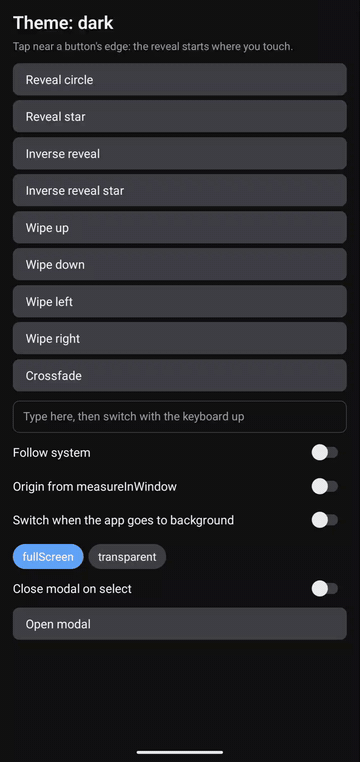
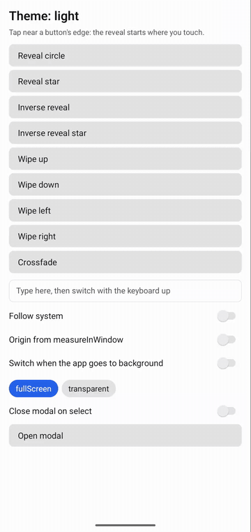
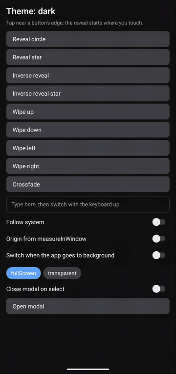
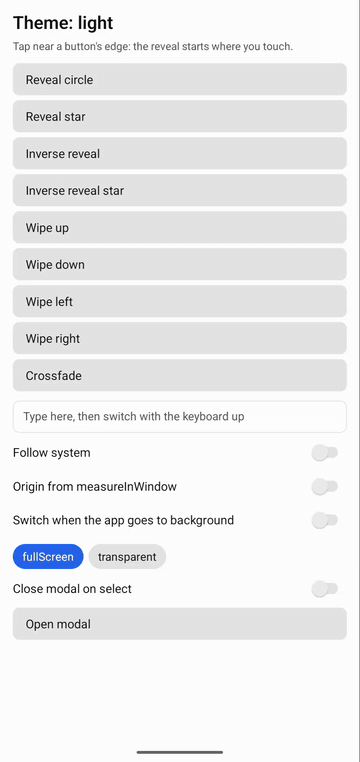

# react-native-theme-reveal

Animated theme switches for React Native, done with a native snapshot of the window: a reveal from the touch
point, an inverse reveal, a wipe or a crossfade.

<p align="center">
  <a href="docs/media/hero-star-reveal.mp4"></a>
</p>

Right before your app applies the new theme, the package snapshots the window and lays the snapshot over your app.
The theme changes underneath, then the snapshot animates away. Your components render the new theme once, and
nothing has to interpolate colours per component.

- Expo module, New Architecture only. Bare React Native apps can use it too, through `install-expo-modules`.
- Android 8.0+ (API 26) and iOS 16.4+.
- No runtime JS dependencies besides React, React Native and Expo.

## Install

In an Expo project:

```sh
npx expo install react-native-theme-reveal
npx expo prebuild
```

There's native code in here, so it won't run in Expo Go. Use a development build (`npx expo run:android`,
`npx expo run:ios`).

In a bare React Native project, set up Expo modules first:

```sh
npx install-expo-modules@latest
npm install react-native-theme-reveal
cd ios && pod install
```

## Quick start

```tsx
import { useRef, useState } from 'react'
import { Pressable, Text, View } from 'react-native'
import type { GestureResponderEvent } from 'react-native'
import { createThemeReveal, originFromPress } from 'react-native-theme-reveal'

type Theme = 'light' | 'dark'

export default function App() {
  const [theme, setTheme] = useState<Theme>('light')
  const themeRef = useRef(theme) // getTheme has to be synchronous, hence a ref mirroring the state
  const [reveal] = useState(() =>
    createThemeReveal<Theme>({
      getTheme: () => themeRef.current,
      setTheme: (next) => {
        themeRef.current = next
        setTheme(next)
      },
    }),
  )
  reveal.useStart() // once, near the root
  const buttonRef = useRef<View>(null)

  const onPress = async (event: GestureResponderEvent) => {
    const origin = await originFromPress(event, buttonRef.current) // the ref is the fallback
    if (origin) reveal.setOrigin(origin.point, origin.viewTag)
    await reveal.switchTo(themeRef.current === 'light' ? 'dark' : 'light')
  }

  return (
    <View style={{ flex: 1, backgroundColor: theme === 'light' ? '#fff' : '#111' }}>
      <Pressable ref={buttonRef} onPress={onPress}>
        <Text style={{ color: theme === 'light' ? '#111' : '#fff' }}>Switch theme</Text>
      </Pressable>
    </View>
  )
}
```

- `getTheme` has to return the current theme synchronously. React state lags behind, so keep the theme in a ref
  (or any store you can read right away).
- `originFromPress` reads the touch point from the press event. Presses from a keyboard, switch control or screen
  reader don't have one, so it measures the view you pass and uses its centre instead.
- The default transition is `reveal` when there's an origin and `crossfade` when there isn't.

The example app in `example/` has every transition, a modal, the keyboard case and the benchmark screen.

## Transitions

| | |
|---|---|
| <a href="docs/media/reveal.mp4"></a> | `reveal`: a hole opens in the old screen at the origin and grows to show the new theme. It's a circle, or a shape you supply. Default 450 ms. |
| <a href="docs/media/inverse-reveal.mp4"></a> | `inverseReveal`: the old screen stays visible only inside the shape, and the shape shrinks into the origin. This clip uses the star shape. Default 450 ms. |
| <a href="docs/media/wipe.mp4"></a> | `wipe`: a straight edge sweeps across the screen and uncovers the new theme. `direction` is the way the edge travels, so with `up` the edge moves up and the new theme comes in from the bottom. Defaults to `up` and 400 ms. |
| <a href="docs/media/crossfade.mp4"></a> | `crossfade`: the old screen fades out. Default 300 ms. |

The clips are screen recordings of the example app (release build) on a Pixel 8 Pro, cut to 30 fps with the status
bar cropped out. Click one to get the MP4.

Motion:
- `reveal` grows the shape from 24 pt tall to whatever scale covers the farthest window corner, following
  `scale(g) = from * (to / from) ^ (g ^ 1.4)` with `g` linear in time. `inverseReveal` runs the same curve
  backwards.
- `wipe` and `crossfade` use a cubic ease in-out (`0.65, 0, 0.35, 1`).

## API

```ts
import {
  createThemeReveal,
  originFromPress,
  resolveTransition,
  ThemeRevealModule,
} from 'react-native-theme-reveal'
```

### `createThemeReveal<T>(options): ThemeReveal<T>`

Create one instance per app, outside render or in a `useState` initializer.

| Option | Type | Default | |
|---|---|---|---|
| `getTheme` | `() => T` | required | Returns the current theme. Must be synchronous. |
| `setTheme` | `(theme: T) => void` | required | Applies the theme. Called while the snapshot is on screen. |
| `transition` | `'reveal' \| 'inverseReveal' \| 'wipe' \| 'crossfade'` | `reveal` with an origin, else `crossfade` | App-wide default. |
| `shape` | `Shape` | a circle | Default shape for `reveal` and `inverseReveal`. |
| `wipeDirection` | `'up' \| 'down' \| 'left' \| 'right'` | `'up'` | Default direction for `wipe`. |
| `durations` | `Partial<Record<TransitionType, number>>` | 450 / 450 / 400 / 300 ms | Per transition type, in ms. |
| `onError` | `(error: unknown) => void` | `console.warn` | Receives native errors. The theme still applies if the snapshot fails. |
| `onSettled` | `(info: SettledInfo) => void` | none | Called when a switch finishes, with `{ transition, prepareMs, totalMs }`. `transition` is `null` if the switch didn't animate. |

### `reveal.setOrigin(point, viewTag?)`

Sets the origin for the next switch only. `point` is in window points (`pageX` / `pageY` space) and `viewTag` is
the tapped view. On Android it tells the package which window to snapshot (see [Modals](#modals)).
`originFromPress` returns both. Call it from the press handler, before `switchTo`.

### `reveal.switchTo(theme, options?): Promise<void>`

Switches to `theme` with an animation.

| Option | Type | |
|---|---|---|
| `transition` | `TransitionType` | This switch only. |
| `shape` | `Shape` | This switch only. |
| `wipeDirection` | `WipeDirection` | This switch only. |

- The most specific choice wins: the `switchTo` option, then the factory option, then the default.
- `reveal` and `inverseReveal` need an origin, and fall back to `crossfade` without one.
- If `theme` is already current, `switchTo` removes any snapshot that's on screen and returns.
- The newest `switchTo` call wins. An older call still waiting for its snapshot does nothing.
- If the snapshot fails, `setTheme` still runs without animation, so the theme always applies.
- The promise resolves once the theme is set, before the animation ends. Use `onSettled` if you need the end.

### `reveal.useStart()`

Hook that starts the animation once React has committed the new theme. Mount it once, in a component that
re-renders when the theme changes (the root is a good spot).

### `reveal.useHeldTheme(): T | null`

Hook that returns the previous theme while an animation is running, and `null` otherwise. Use it for anything
outside the snapshot that needs to keep the old look until the animation ends, like the system bar style:

```tsx
const held = reveal.useHeldTheme()
const barTheme = held ?? theme

return <StatusBar barStyle={barTheme === 'light' ? 'dark-content' : 'light-content'} />
```

The system bars stay live above the snapshot, so if you switch their style right away, they change before the
animation has shown the new theme.

### `originFromPress(event, fallbackView?): Promise<PressOrigin | null>`

Returns `{ point, viewTag }` for a press event, where `point` is the touch point (`pageX`, `pageY`) and `viewTag`
is `event.nativeEvent.target`. If the event has no touch point, it measures `fallbackView` with `measureInWindow`
and returns its centre, or `null` if you didn't pass a `fallbackView`.

### `resolveTransition(input): Transition`

Pure function that picks the transition, shape, direction and duration for a switch. `switchTo` uses it
internally, and it's exported for tests and custom flows.

### `ThemeRevealModule`

The native module, with `prepare(viewTag?)`, `start(transition)` and `cancel()`. `createThemeReveal` calls it for
you, so normally you won't need it.

### Types

```ts
type Point = { x: number; y: number }
type Shape = { path: string; anchor: Point; inscribedRadius: number }
type WipeDirection = 'up' | 'down' | 'left' | 'right'
type Transition =
  | { type: 'reveal'; origin: Point; durationMs: number; shape?: Shape }
  | { type: 'inverseReveal'; origin: Point; durationMs: number; shape?: Shape }
  | { type: 'wipe'; direction: WipeDirection; durationMs: number }
  | { type: 'crossfade'; durationMs: number }
type TransitionType = Transition['type']
type SettledInfo = { transition: TransitionType | null; prepareMs: number; totalMs: number }
type SwitchOptions = { transition?: TransitionType; shape?: Shape; wipeDirection?: WipeDirection }
type PressOrigin = { point: Point; viewTag?: number }
type MeasurableView = {
  measureInWindow(callback: (x: number, y: number, width: number, height: number) => void): void
}
type ResolveTransitionInput = {
  requested?: TransitionType // the switchTo option
  fallback?: TransitionType // the factory option
  origin: Point | null
  shape?: Shape
  durations?: Partial<Record<TransitionType, number>>
  wipeDirection?: WipeDirection
  requestedShape?: Shape
  requestedWipeDirection?: WipeDirection
}
```

`ThemeRevealOptions<T>` is the options object for `createThemeReveal` (the table above) and `ThemeReveal<T>` is
what it returns. All of these types are exported.

## Shape format

A shape is SVG path data plus two numbers that position and scale it, all in path units.

```ts
const STAR: Shape = {
  path:
    'M50 0 L62.93 32.2 L97.55 34.55 L70.92 56.8 L79.39 90.45 L50 72 ' +
    'L20.61 90.45 L29.08 56.8 L2.45 34.55 L37.07 32.2 Z',
  anchor: { x: 50, y: 50 },
  inscribedRadius: 21.99,
}

await reveal.switchTo('dark', { transition: 'reveal', shape: STAR })
```

- `path`: SVG path data, filled with the nonzero rule on both platforms.
- `anchor`: the point in the shape that lands on the origin.
- `inscribedRadius`: distance from the anchor to the nearest edge of the shape. The package uses it to work out
  the scale at which the shape covers the whole window, so use a value at or below the real distance. Too large a
  value makes the final scale too small, and whatever the shape missed snaps to the new theme at the end.
- If the path doesn't parse, the package falls back to the circle.

## Modals

A switch from inside a React Native `<Modal>` animates too.

- Android: a modal is its own dialog window. Pass the tapped view's tag (`setOrigin(point, viewTag)`, which
  `originFromPress` gives you) and the package snapshots the activity window, the dim behind the dialog and the
  dialog itself, then puts the overlay in the dialog window. Without a `viewTag` it uses whichever window has
  focus.
- iOS: a modal is in the same window, so the snapshot includes it.

## Reduce Motion and backgrounding

- iOS: with Reduce Motion on, the theme switches without animating.
- Android: with the animator duration scale at 0 (Remove animations), the theme switches without animating.
- The app has to be in the foreground. If it's paused or in the background, a switch applies the theme without
  animating.
- If a snapshot never gets its animation start, it's removed after 1 s, so it can't get stuck on screen.

## Limits

- Android 8.0+ (API 26). Below that the theme still switches, just without animation.
- New Architecture only.
- The keyboard isn't in the snapshot. On iOS it changes theme immediately, and on Android it keeps its own theme.
- Starting a second switch mid-animation ends the first one immediately. Android shows one frame of the end state.
- Android modal: tapping while the modal is still sliding in shows about 2 frames of live content on top of it.
- Android modal: with stacked modals, only the target dialog ends up in the snapshot.
- Android modal: if the dialog window is smaller than the screen, the strip outside it stays live.
- Closing a modal in the same handler that switches ("close on select") means no animation. Switch once the modal
  has closed.
- To follow the system theme, listen to `Appearance` and call `switchTo` without an origin, which gives you a
  `crossfade`. The example app does this.

## Performance

Measured on 2026-10-28 with release builds. The method, raw dumps and scripts live in [`benchmark/`](benchmark/),
and the detailed results and notes are in [`benchmark/RESULTS.md`](benchmark/RESULTS.md).

Everything runs in one build of the example app, on the same screen, with a 450 ms circle reveal:
- `ours`: this package.
- `theme-switch-animation`: `react-native-theme-switch-animation` 0.8.0.
- `skia`: the Skia technique, `@shopify/react-native-skia` `makeImageFromView` with a circle mask animated by
  Reanimated.

| Device | OS | Build | Runs per library |
|---|---|---|---|
| Xiaomi Mi 11 Lite (`M2101K9AG`) | Android 13 (API 33) | release, `arm64-v8a` | 1 warm-up + 6 interleaved rounds, median of 6 |
| Pixel 8 Pro | Android 17 (API 37) | release, `arm64-v8a` | 1 warm-up + 6 interleaved rounds, median of 6 |
| iPhone 17 Pro simulator on a Mac | iOS 26.5 | Release, simulator | 1 warm-up + 6 interleaved rounds, median of 6 |

Both Android phones drew at 60 Hz during these runs. Lower is better in every column.

| Device | Library | Overlay frame (ms) | Snapshot, JS (ms) | Frame p50 (ms) | Frame p90 (ms) | Janky (%) | Late frames | Missed vsyncs | JS max gap (ms) |
|---|---|---|---|---|---|---|---|---|---|
| Mi 11 Lite | ours | 84.8 | 72.6 | 16.5 | 23.2 | 47 | 1 | 4 | 39.0 |
| Mi 11 Lite | theme-switch-animation | 91.4 | 80.4 | 17.2 | 22.6 | 61 | 1 | 4 | 37.0 |
| Mi 11 Lite | skia | 432.9 | 400.5 | 18.4 | 25.0 | 68 | 1 | 25 | 374.9 |
| Pixel 8 Pro | ours | 72.3 | 60.1 | 5.6 | 8.0 | 0 | 0 | 4 | 28.0 |
| Pixel 8 Pro | theme-switch-animation | 62.8 | 58.1 | 8.3 | 9.6 | 5 | 1 | 3 | 25.1 |
| Pixel 8 Pro | skia | 313.4 | 285.4 | 7.1 (1) | 9.7 (1) | 0 (1) | 0 (1) | 9 | 265.7 |

(1) Skia drew at 30 Hz on the Pixel 8 Pro, so its frame times, janky share and late frames there can't be compared
with the other two.

- Overlay frame: time from the touch to the first frame with the overlay on screen. On the Mi 11 Lite a system
  trace confirmed which frame that is. On the Pixel 8 Pro it rests on `gfxinfo` data alone.
- Snapshot, JS: time from the touch until JS knows the overlay is up.
- JS max gap: longest gap between two `requestAnimationFrame` callbacks during the switch.
- On React Native 0.86 (Fabric), `theme-switch-animation` shows no visible circle: it reveals the old screen over
  the old screen, and the new theme appears all at once at the end. Its timings are still real.

### Where ours loses

The release rule: on each Android device, each of our medians has to be no more than 5% above the best
alternative's median. Ours fails that on four metrics:

- Mi 11 Lite, JS max gap: 39.0 ms vs 37.0 ms for `theme-switch-animation` (+5.4%), against a limit of 38.9 ms. The
  difference is within the spread between measurement passes, but it's still over the limit. I haven't traced the
  cause.
- Pixel 8 Pro, overlay frame: 72.3 ms vs 62.8 ms for `theme-switch-animation` (+15%). Our overlay shows up about
  one frame later.
- Pixel 8 Pro, missed vsyncs: 4 vs 3 for `theme-switch-animation` (one frame interval).
- Pixel 8 Pro, JS max gap: 28.0 ms vs 25.1 ms for `theme-switch-animation` (+12%). I haven't traced the cause.

Where the snapshot cost comes from (measured): ours reads the window back from the GPU with `PixelCopy`, which
gives a pixel-exact snapshot. On the Mi 11 Lite a system trace shows this readback taking 25-47 ms for a 1080 x
2400 window, mostly waiting on the GPU. `theme-switch-animation` draws the view tree into a software canvas
instead. I couldn't get a system trace on the Pixel 8 Pro, so there the same readback cost is the likely cause but
not a measured one.

On the first switch in a fresh process (no warm-up), ours is slower in four places. Each value is a median of only
3 runs, so these numbers are noisy.
- Pixel 8 Pro, overlay frame: 121.2 ms vs 96.7 ms for `theme-switch-animation` (+25%).
- Pixel 8 Pro, snapshot JS: 100.5 ms vs 71.7 ms for `theme-switch-animation` (+40%).
- Pixel 8 Pro, JS max gap: 36.1 ms vs 29.2 ms for `theme-switch-animation` (+24%).
- Mi 11 Lite, JS max gap: 93.9 ms vs 41.2 ms for `theme-switch-animation` (2.3 times), which is also 2.4 times our
  own warm value.

On the Mi 11 Lite, ours wins the first-switch overlay frame and snapshot JS (89.0 and 68.8 ms vs 123.1 and 98.1
ms). The full first-switch table is in [`benchmark/RESULTS.md`](benchmark/RESULTS.md).

### iOS (simulator)

These numbers are from the iOS 26.5 simulator on a Mac, not a phone. Frame metrics aren't available on the
simulator.

| Library | Snapshot, JS (ms) | JS max gap (ms) |
|---|---|---|
| ours | 8.3 | 16.8 |
| theme-switch-animation | 11.8 | 16.9 |
| skia | 44.0 | 18.0 |

The benchmark script can't tap on the simulator, so on iOS "Snapshot, JS" is measured from the run call instead of
a touch.

## License

MIT
